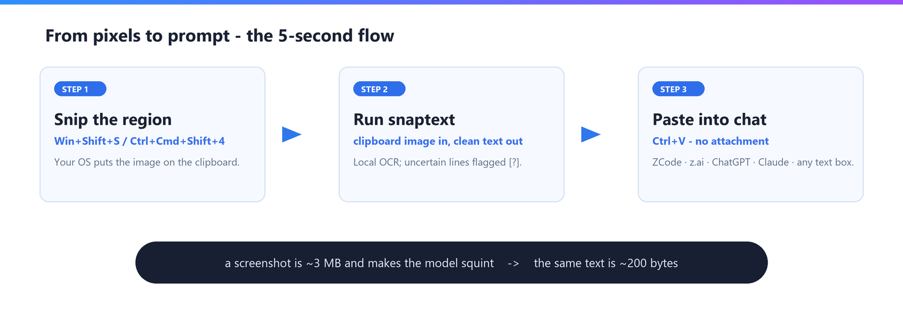
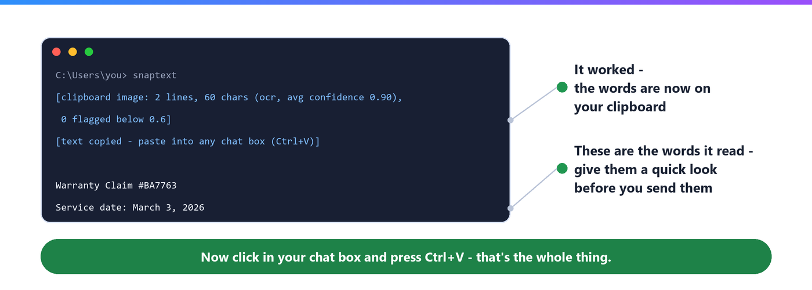

# Using snaptext — copy words from your screen into any chat

This guide is for people who just want snaptext to work and don't care how.
If you like technical detail, the [README](README.md) is the one for you.

> **Not installed yet?** Ask whoever sent you here, or follow the Install
> steps in the [README](README.md#%EF%B8%8F-install). This guide picks up
> after that.

## What it does

snaptext reads the words out of a picture and hands them to you as plain
text, ready to paste into any chat — Z.ai, ChatGPT, Claude, ZCode, a text
message, an email, anything.

Why not just attach the picture? Two reasons, in plain words:

- Pictures are **heavy**. One screenshot can weigh as much as a thousand
  copies of the words inside it. Some chats slow down, refuse, or charge
  you for that.
- Chat AIs often **misread small or blurry text** in pictures. Pasting the
  actual words gets you better answers.

Everything happens on your computer (see [Is this private?](#is-this-private)).

## The everyday move

Three steps, about ten seconds:

1. **Take a snip of the text you want.**
   - **Windows:** press **Win + Shift + S**, then drag a box around the text.
   - **Mac:** press **Ctrl + Cmd + Shift + 4**, then drag the box.
   - **Linux:** use your usual screenshot tool — the one that *copies* the
     picture.

2. **Run snaptext.** Open the small black window where you type things:
   - **Windows:** press the **Start** key, type `cmd`, press **Enter**.
   - **Mac:** open **Terminal** (Applications → Utilities → Terminal).
   - **Ubuntu:** press **Ctrl + Alt + T**.

   Type `snaptext` and press **Enter**. That's the whole command.

3. **Paste into your chat.** Click the chat box and press **Ctrl + V**
   (Mac: **Cmd + V**).

When it works, you'll see something like this:

The two lines in square brackets are just snaptext saying *it worked* — you
can ignore the numbers in them. The lines after that are the words it read.

## Grab words from a photo, scan, or PDF file

When the text lives in a file (a `.jpg` photo, a `.png` scan, or a `.pdf`
letter):

1. Open the black window, as in step 2 above.
2. Type `snaptext file ` — with a space after it — then **drag the file from
   its folder straight into the black window** (on most systems this types
   the file's location for you) and press **Enter**.
3. The words appear in the window, **and a matching `.txt` file is saved
   next to the original** — for `letter.pdf` you get `letter.txt` in the
   same folder. Open it with any notes app and copy what you need.

## What the ` [?]` marks mean

Sometimes a line ends with ` [?]`. That's snaptext being honest: *"I'm not
sure I read this line correctly."* It usually means handwriting, a fancy
font, or a blurry photo.

Check those lines against the original before you trust them. Once you've
checked, feel free to delete the marks — they're only there for you.

## "Windows protected your PC" and other scary messages

These pop up because snaptext is free software that doesn't pay Microsoft
or Apple for a rubber stamp. **They do not mean a virus.**

- **Windows** shows a blue box, *Windows protected your PC*:
  click **More info** → **Run anyway**.
- **Mac** says it *"can't be opened because it is from an unidentified
  developer"*: close that message, then **right-click** (or Ctrl-click) the
  app → **Open** → **Open** again.
- The **first run takes a few extra seconds** — it's loading its reading
  machinery. Later runs are quicker.

## Is this private?

Yes. snaptext works entirely on your computer. Your words and pictures are
not sent anywhere, to anyone, ever.

## Quick fixes

| What you see | What to do |
|---|---|
| `no image on the clipboard` | The snip didn't happen or got lost — take it again (step 1), then run `snaptext` again. |
| `no text found` | The picture had no readable words, or they were tiny. Try a tighter snip, or zoom the screen in first. |
| The text looks like gibberish | Probably handwriting — snaptext can't read handwriting. Type those lines yourself. |
| `'snaptext' is not recognized` | It isn't installed (or not on this machine). Follow the [Install](README.md#%EF%B8%8F-install) steps again. |
| A line ends in ` [?]` | Not an error — see [above](#what-the--marks-mean). |
| Windows/Apple warning box | Not an error — see [the scary messages section](#windows-protected-your-pc-and-other-scary-messages). |

## Coming later

Right now snaptext is a command you type once in a while. A friendlier
version — one that sits quietly in your menu bar and works with a single
keypress — is on the roadmap. The foundations are already in the code; the
friendly face isn't built yet.

---

Questions or something badly broken? Ask the person who pointed you here, or
open an issue on the project page.
