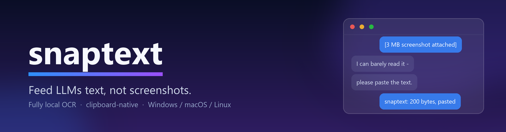
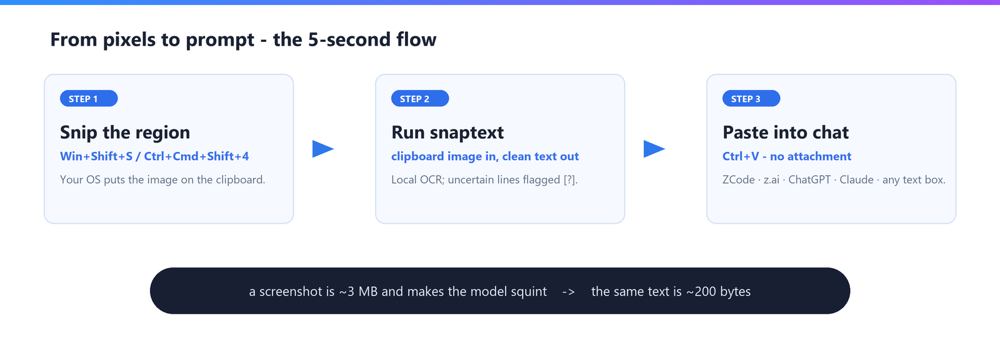

<div align="center">



# snaptext

**Feed LLMs text, not screenshots.**

Turn anything you can see on screen — an error dialog, a settings pane, a scanned
letter — into clean text on your clipboard, ready to paste into
ZCode · z.ai · autocrawl · ChatGPT · Claude · any box that accepts text.

Fully local. No cloud. No admin rights.

[](LICENSE)
[](pyproject.toml)
[](#-how-each-os-is-supported)
[](#%EF%B8%8F-design-rules-this-project-lives-by)

[Why](#-why) · [The 5-second flow](#-the-5-second-flow) · [Commands](#-commands) · [Install](#%EF%B8%8F-install) · [Platform support](#-how-each-os-is-supported) · [Token costs](docs/token-costs.md) · [DIY builds](BUILDING.md)

</div>

## 🎯 Why

> **Chat models turn images into thousands of tokens before reading a word —
> and you pay for pixels, not content.**

| The same paragraph, two ways | Input tokens |
|---|---|
| Pasted as text | ~60 |
| Attached as a full-screen screenshot | ~1,000–4,000 |

A screenshot is billed by its size, not by the text it carries: one error
dialog in the corner of a full-screen capture costs like a dense page. The
image rides along in context and is re-sent on every follow-up, and the
model still squints — misread glyphs mean correction rounds, each one
paying for the picture again.

**snaptext sends ~200 bytes of exact text instead — to any chat, from any
screen.**

- **Smaller prompts** — 3 MB PNG → 200 B of text, typically a 15–50× token
  saving per message.
- **Works everywhere** — text-only inputs, terminals, and API calls included.
- **Honest OCR** — lines the engine read with low confidence carry a ` [?]`
  marker, so you (and the model) know exactly what to double-check.
- **Private** — recognition runs on your machine via ONNX Runtime. Nothing
  leaves it.

For the per-provider math — how OpenAI, Anthropic and Google actually count
image tokens, worked examples, and how to measure it yourself — see
**[the technical note](docs/token-costs.md)**.

## ⚡ The 5-second flow



```bash
# 1. Snip: Win+Shift+S   (or Ctrl+Cmd+Shift+4 on macOS, your desktop's tool on Linux)
# 2. OCR the clipboard and put text back on it:
snaptext
# 3. Ctrl+V into the chat. Done.
```

Keep it resident for one-keystroke capture with a warm engine:

```bash
pip install ".[hotkey]"
snaptext hotkey --mode paste   # recommended: snip with your OS tool, then press the hotkey
```

## 📦 Commands

| Command | What it does |
|---|---|
| `snaptext` | clipboard image → OCR → text on clipboard **(the main flow)** |
| `snaptext hotkey [--key K] [--mode snap\|paste]` | resident mode: one key, warm engine, capture → clipboard |
| `snaptext file X.pdf PHOTO.jpg [-o out.txt]` | batch: extract text from files |
| `snaptext pdf scan.pdf` | searchable PDF (invisible text under the original scan) |
| `snaptext snap [--region L,T,W,H]` | capture the screen → OCR → clipboard |
| `snaptext watch folder [--once]` | auto-extract anything dropped into a folder |

Every run reports `lines, chars, avg confidence, flagged count` so you know
exactly what you are about to paste.

## 🛠️ Install

```bash
python -m venv .venv
# Windows:      .venv\Scripts\activate
# macOS/Linux:  source .venv/bin/activate
pip install .
```

Pure pip wheels on all three OSes; OCR models download on first run.
PDFs that already have a text layer are read directly (no OCR, no loss);
image-only PDFs, photos and screenshots get EXIF rotation and auto-contrast,
then local OCR.

**DIY builds** — standalone binaries via `pyinstaller snaptext.spec`, a
Docker image, or OS-native packages (setup.exe / .app / .deb): see
**[BUILDING.md](BUILDING.md)**.

## 💻 How each OS is supported

| Capability | Windows | macOS | Linux |
|---|---|---|---|
| Core pipeline (bare/file/pdf/watch) | pip | pip | pip |
| Snip → `snaptext` flow | `Win+Shift+S` | `Ctrl+Cmd+Shift+4` | desktop screenshot tool |
| Direct capture (`snap`) | mss, out of the box | mss; Screen Recording permission (10.15+) | X11: works; Wayland: use the snip flow |
| Clipboard text out | native | `pbcopy`/`pbpaste` (built in) | `xclip`/`xsel` (X11) or `wl-clipboard` (Wayland) — one distro package |
| Clipboard image in | built in (Pillow) | built in (Pillow) | `xclip` / `wl-paste` as above |
| `hotkey` (needs `.[hotkey]` extra) | works | needs Accessibility permission | X11 (may need root); Wayland: use `--mode paste` |

The snip-plus-paste flow is deliberately primary: every OS already ships a
perfect region selector that copies to the clipboard, so snaptext only does
the OCR half — one codebase, three platforms.

## 🧭 Design rules this project lives by

- **The clipboard is the universal LLM integration.** Every chat UI accepts
  pasted text, so there will never be per-service plugins for z.ai, ZCode or
  anyone else — that code would rot as soon as their UIs change.
- **The pasted text is the prompt.** No boilerplate, no branding ever lands
  on the clipboard — exact recognized text only.
- **Success metric:** time from seeing text on screen to clean text in a
  chat box. Features that don't reduce that (or its error rate) are scope
  creep: no screenshot editing, no cloud, no document management.

## ⚠️ Limitations

- Handwriting is flagged (`[?]`), not solved — review those lines yourself.
- Reading order is top-to-bottom; two-column layouts will interleave.
- Searchable-PDF text overlay is Latin-only and line-approximate (selectable
  and searchable, not pixel-aligned); `.txt` output has no such limit.

## 📄 License

Released under the [Apache License 2.0](LICENSE).

OCR by [RapidOCR](https://github.com/RapidAI/RapidOCR) (Apache-2.0) on
[ONNX Runtime](https://onnxruntime.ai).
